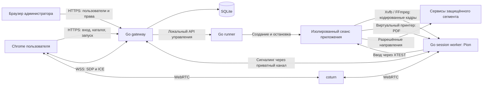

# mvp1: публикация приложений через WebRTC

Статус: базовая архитектура принята 2026-09-17; открытые детали отмечены ниже.
Документ описывает проектируемую систему, а не реализованные функции.

## 1. Назначение и требования

Пользователь входит через Chrome или совместимый браузер, видит разрешённые
приложения, запускает Firefox или terminal на сервере защищённого сегмента
и управляет ими через WebRTC. Аналогия продукта — публикация приложений RemoteApp.
Приложение исполняется на сервере; клиент получает изображение и отправляет ввод.

Подтверждено пользователем:

- не больше двух одновременных пользователей;
- пользователи независимы; SFU в пилоте не нужен;
- до двух активных приложений на пользователя в пилоте, до четырёх на стенд;
- в будущем до трёх приложений на пользователя в отдельных вкладках;
- клавиатура и мышь через DataChannel;
- передача задания локальной печати из серверного Firefox через DataChannel;
- SQLite с возможностью явно задать логин и пароль;
- несколько ролей и администратор, управляющий доступом к приложениям;
- coturn для NAT и Pion для серверного WebRTC;
- Go gateway и предложенное изолированное Linux-окружение приложений приняты;
- серверная платформа — Linux; клиентские — Linux, Windows и macOS через браузер;
- приоритет MVP — показать полный клиентский путь и удобство реальной работы;
- в будущем возможен отдельный Electron-клиент, без обязательства включать его в MVP;
- предусмотрен будущий переход к отдельному API gateway;
- собственная реализация проекта на Go;
- отдельные каталоги для тестирования и рабочего запуска.

Поведение первого прототипа подтверждено в [ADR-005](adr/005-first-pilot-behavior.md):
одноразовые профили, изолированная shell, PDF и локальный диалог печати;
без звука, общего буфера обмена и общего файлового обмена.

Детали реализации:

| Аспект | Решение для MVP |
| --- | --- |
| Клиент | HTML/CSS и небольшой JavaScript-модуль для браузерных API |
| Локальная печать | PDF, переданный по DataChannel, затем обычный диалог печати |
| Данные после выхода | Одноразовые профили; краткий reconnect сохраняет живой процесс |
| Дополнительные потоки | Без звука, камер, микрофонов, общего clipboard и файлового обмена |

Нужно также определить серверные ресурсы, расположение TURN и разрешённые
сетевые направления. Для terminal выбрана shell внутри изолированного
окружения. Полная shell даёт возможность
запускать доступные в этом окружении команды; каталог приложений её не ограничивает.

## 2. Схема и компоненты



На схеме показан путь через TURN. PeerConnection соединяет Chrome и Go worker;
coturn пересылает пакеты и не завершает этот PeerConnection.
Можно разрешить прямое соединение как оптимизацию либо включить relay-only.
Для первого сетевого испытания использовать принудительный relay.

**Go gateway:** UI из встроенных статических файлов, HTTP API, login/logout,
RBAC, каталог, SQLite, создание сеансов и WebSocket-сигналинг. Один экземпляр,
без Redis, брокера сообщений и распределённой БД.

**Go runner:** небольшой локальный процесс с доступом к контейнерному runtime.
Принимает только структурированные запросы запуска утверждённых шаблонов.
Привилегированный socket runtime не передаётся в пользовательские контейнеры.
Приватный Unix socket и права ОС ограничивают вызовы runner со стороны gateway.

**Go session worker:** один процесс на активное приложение, библиотека Pion,
видеотрек, DataChannels, управление захватом, вводом и доставкой PDF. Соединение
worker с gateway аутентифицируется одноразовым секретом запуска и session ID.
Worker получает только параметры собственного сеанса, без БД пользователей.
Приватный канал worker/gateway проходит по отдельной управляющей сети.

**Контейнер приложения:** Firefox либо графический terminal, Xvfb, минимальный
оконный менеджер для диалогов, FFmpeg, Go worker; для Firefox — виртуальная печать.
Runner задаёт отдельные профиль, display, файловую систему и print spool.
Один display обслуживает одно опубликованное приложение и его дочерние окна.
В нём нет общего рабочего стола с меню запуска других приложений.

**coturn:** отдельный сервис на адресе, достижимом для клиента и worker.
Поддерживает STUN/TURN и транспорт клиента UDP/TCP/TLS; размещение и правила
relay требуют согласования с топологией стенда. [Документация coturn](https://github.com/coturn/coturn).

SFU/MCU в пилоте не нужны: пользователи и их приложения независимы.
Каждое приложение имеет собственный сеанс и PeerConnection. У пользователя
до двух таких сеансов в отдельных вкладках; на стенде — до четырёх.
Расширение до трёх приложений на пользователя описано в
[ADR-002](adr/002-concurrent-applications.md).

В будущем перед Go backend появится отдельный API gateway для HTTP/WSS.
Прикладные сервисы отделяются от транспортных обработчиков уже в пилоте;
публичный API использует `/api/v1`. WebRTC-медиа и DataChannels продолжают
работать через Pion/coturn. Границы и план перехода:
[ADR-003](adr/003-api-gateway-evolution.md).

## 3. Захват и удалённый ввод

Начальный медиапайплайн: `Firefox/terminal → Xvfb → FFmpeg → VP8 → Pion → video`.
FFmpeg выполняет захват и кодирование; Pion доставляет уже кодированные данные.
Для прототипа рассмотреть поток IVF через pipe с временными метками кадров.
FFmpeg поддерживает захват X11, у Pion есть примеры отправки кодированного видео
и DataChannels. Это подтверждает наличие компонентов, но не проверяет весь pipeline.
[FFmpeg x11grab](https://www.ffmpeg.org/ffmpeg-devices.html#x11grab),
[примеры Pion](https://github.com/pion/webrtc/blob/main/examples/README.md).

Начальный профиль для измерений: 1280×720, 20–30 fps, ограниченный bitrate.
Это настройка прототипа, не обещанная производительность. Проверить читаемость
текста и задержку; после измерений сравнить 1080p и H.264, если это необходимо.
Читать RTCP, включить поддерживаемые механизмы повторной передачи, определить
реакцию на PLI и получение нового keyframe. Для простого FFmpeg-pipe использовать
ограниченный интервал ключевых кадров; не обещать принудительный keyframe без
реализованного механизма. Не накапливать очередь устаревших кадров при перегрузке.

DataChannels в пределах одного PeerConnection:

| Канал | Доставка | Назначение |
| --- | --- | --- |
| `control` | Надёжная, упорядоченная | keydown/up, кнопки мыши, wheel, reset-input, управляющие ответы |
| `pointer` | Без повторов, неупорядоченная | Частые перемещения курсора, sequence number |
| `print` | Надёжная, упорядоченная | Метаданные и бинарные блоки PDF |

Сообщения имеют версию протокола и поколение подключения. Сессию определяет
серверная привязка PeerConnection, а не присланный клиентом user ID.
Mouse-down/up включают текущие координаты: порядок между разными каналами
не гарантирован. Старые pointer-события отбрасываются по sequence number.
Координаты нормализуются по видимой области видео с учётом полей и масштабирования.

Go input adapter переводит события в XTEST конкретного display, с проверкой
типов, диапазонов и частоты. Не запускает shell-команды на каждое нажатие.
XTEST поддерживает синтетические события клавиатуры и мыши.
[XTEST](https://www.x.org/releases/X11R7.5/doc/Xext/xtestlib.html).

Отдельно проверить RU/EN, модификаторы, повтор клавиш и переключение раскладки.
Физические клавиши и ввод текста требуют разных правил; полную IME-совместимость
не считать готовой до проверки. При blur, disconnect и смене приложения сбрасывать
все зажатые клавиши. Часть сочетаний перехватывается локальной ОС/браузером;
для необходимых сочетаний сделать экранные кнопки. Получение разрешений камеры
и микрофона пользователю не требуется, поскольку его медиа не захватываются.

## 4. Печать на стороне пользователя

Предлагаемый путь:

1. Пользователь вызывает печать в серверном Firefox, в том числе с кнопки сайта.
2. Выбирает виртуальный принтер «Локальный принтер пользователя».
3. Firefox формирует PDF и отправляет его виртуальному IPP-принтеру на Go.
4. Worker принимает готовый PDF в ограниченную очередь памяти и передаёт владельцу через `print`.
5. Клиент проверяет размер и контрольную сумму, формирует PDF Blob.
6. Пользователь открывает PDF по ссылке и выбирает физический принтер в локальном диалоге.

Выбор Go IPP принят пользователем: [ADR-007](adr/007-go-ipp-printing.md).
Отдельного демона CUPS нет. Клиентская библиотека Firefox использует
`CUPS_SERVER=127.0.0.1:8631` внутри контейнера. Принтер принимает только PDF,
не загружает документы по URL. Очередь привязана к worker, а не к имени задания.
Готовность PDF проверяется до включения в очередь; размер ограничен 25 MiB,
число документов — двумя. Хранение в памяти ограничено 10 минутами.

Передача: `job-start(id, size, sha256) → chunks(job-id, offset, bytes) → job-end → ack`.
Предварительные лимиты MVP: PDF до 25 MiB, блок до 16 KiB и не выше согласованного
SCTP max-message-size, одно передаваемое задание на сеанс. Ограничивать очередь,
скорость и объём буфера отправки. Каналы делят сеть: отдельный DataChannel не
гарантирует, что большой PDF не ухудшит управление. Нужен тест одновременной печати
и ввода. [Управление буфером DataChannel](https://developer.mozilla.org/en-US/docs/Web/API/RTCDataChannel/bufferedAmount).

При обрыве MVP повторяет передачу PDF целиком с тем же job ID; клиент устраняет
дубликаты. При отзыве права печати передача прекращается. Очередь имеет ограничение
объёма и срок хранения; при завершении одноразового сеанса очищается.

Обычный браузерный сценарий — диалог печати. `window.print()` открывает диалог,
но не даёт серверу API произвольного выбора принтера или подтверждения физической
печати. Не вызывать `print()` на странице видеоплеера: она напечатает саму страницу,
а не удалённый документ. Для MVP открывать полученный PDF по явному нажатию,
с возможностью сохранить PDF как запасным вариантом.
[Browser print API](https://developer.mozilla.org/en-US/docs/Web/API/Window/print).

Статус задания — «передано клиенту», а не «напечатано». PDF оказывается на компьютере
пользователя; право `print` разрешает именно такую передачу документа. Автопечать
без диалога и запрет сохранения PDF требуют другого клиентского решения.

## 5. Пользователи, роли и приложения

SQLite подходит по предполагаемому объёму и работе на одном сервере; БД хранится
на локальном диске gateway. [Область применения SQLite](https://www.sqlite.org/whentouse.html).
Модель данных, пока без окончательной SQL-миграции:

| Таблица | Данные |
| --- | --- |
| `users` | id, уникальный login, password, enabled |
| `roles` | id, уникальное имя, признак права администрирования |
| `user_roles` | user_id, role_id; несколько ролей у пользователя |
| `applications` | id, имя, template_id, разрешённые настройки, enabled |
| `role_app_permissions` | role_id, app_id, can_launch, can_control, can_print |
| `auth_sessions` | хеш случайного session token, user_id, expires_at |
| `app_sessions` | id, user_id, app_id, worker_id, state, generation, timestamps |
| `print_jobs` | id, app_session_id, size, checksum, delivery_status, expires_at |
| `audit_events` | actor_id, action, object_id, result, timestamp |

С 2026-10-07 пароль хранится в `users.password_hash` как Argon2id-хеш
с индивидуальной солью (ADR-011). Прежнее упрощение с открытыми паролями отменено.
Начальные учётные записи задаёт оператор; встроенных паролей нет. Пароли и хеши
не выдаются API. Аутентификация имеет абсолютный срок один час; активность,
переподключение и обновление страницы его не продлевают.

Стартовые роли: `admin` и `user`; дополнительные роли администратор создаёт
для наборов приложений, например `browser-users` и `terminal-users`.
Разрешения пользователя — объединение разрешений назначенных ролей; нет grant —
доступ запрещён. В MVP нет явных deny и прямых исключений на пользователя.
`can_control` и `can_print` применяются только при `can_launch`.

Администратор управляет пользователями, ролями, публикациями и разрешениями,
видит состояние сеансов и может их завершить. Право администрирования само по себе
не даёт просмотра изображения чужого сеанса. Администратор публикует приложения
из предустановленных шаблонов; произвольные команды, образы и mount-пути не принимаются
через UI. Новые типы приложений добавляет оператор в конфигурацию runner.

Доступ проверяется при показе каталога, запуске, сигналинге, подключении worker,
вводе и передаче PDF. Скрыть плитку в UI недостаточно. При отключении пользователя,
отзыве launch или отключении приложения активный сеанс завершается; при отзыве
control/print соответствующее действие блокируется немедленно. Gateway обновляет
политику worker; при утрате управляющего канала worker прекращает ввод и печать.

HTTP-аутентификация: случайная серверная сессия в HttpOnly/Secure/SameSite cookie,
проверка CSRF для изменений и Origin при WSS. Авторизация HTTP и TURN раздельная:
gateway выдаёт ограниченные по времени TURN credentials для разрешённого сеанса.

## 6. Изоляция и доступ к сегменту

Контейнер создаётся на активное приложение; Firefox/terminal работают под UID 1000.
Управляющий worker имеет отдельный UID и ограниченные capabilities, как описано
в [ADR-006](adr/006-worker-process-isolation.md). Исходное предложение окружения —
с непривилегированным пользователем,
отдельными X11 socket, профилем и spool. Не передавать host filesystem, X11 хоста,
БД, секреты gateway и runtime socket. Ограничить CPU, RAM, процессы и временный диск.
Контейнер — граница MVP для доверенного стенда, а не эквивалент отдельной VM.

Разрешения публикации и сетевые разрешения различаются. Firefox может обращаться
по URL, а terminal исполнять команды: сеть окружения должна пропускать только
назначенные приложению адреса/порты или утверждённый proxy. Для полноценного
ограничения браузера использовать правила egress, а не только стартовый URL.
Конкретный список внутренних сервисов ещё требуется от пользователя.

В браузер не передаётся универсальный TCP-туннель в защищённый сегмент.
DataChannel принимает только известные сообщения ввода, управления и печати.
Доступ приложения к внутренним серверам происходит из его серверного окружения.

## 7. Сеть и жизненный цикл

HTTPS/WSS: 443 на gateway. TURN: настраиваемые UDP/TCP listeners (обычно 3478),
TLS listener (обычно 5349) и явный диапазон UDP relay. Для сетей только с TCP/443
можно выделить TURN/TLS отдельный IP: он не является обычным HTTP/WebSocket
и не размещается за HTTP-прокси простым добавлением URL. [coturn](https://github.com/coturn/coturn).

TURN должен быть достижим с обеих сторон. Одного размещения coturn внутри
недоступного сегмента недостаточно: необходимо разрешённое сетевое направление.
Ограничить relay допустимыми WebRTC endpoints, согласовав запреты private peers
с реальными адресами worker. Не открывать через coturn доступ к произвольным
внутренним сервисам. Проверить UDP, TURN/TCP и TURN/TLS именно на данном стенде.

Сценарий: `login → каталог → запуск → preparing → ready → connecting → active`.
При старте gateway проверяет права и атомарно резервирует слот: максимум два
активных пользователя, два приложения на пользователя и четыре на стенд.
Вход сам по себе слот не занимает. Все незавершённые состояния, включая
preparing, ready, connecting, reconnecting и stopping, занимают слот до cleanup.
После резервирования
runner запускает приложение; WSS сигналинг начинается после готовности worker.
Chrome создаёт offer, worker возвращает answer, ICE передаётся через gateway.

При обрыве: `active → reconnecting → active` либо `stopping → closed`.
Предлагаемый grace period — 60 секунд. Повторный вход создаёт новое поколение
PeerConnection, но использует ещё живое приложение того же владельца.
Старое соединение больше не принимает ввод и не закрывает новый сеанс.
Явный выход, отзыв прав и окончание grace period останавливают всю группу
процессов конкретного приложения и освобождают его слот. Закрытие приложения
не затрагивает другие приложения пользователя; logout и отключение пользователя
завершают все его сеансы. После рестарта gateway MVP завершает осиротевшие
workers и отмечает их сеансы закрытыми; бесшовное восстановление после рестарта
не включено. Изменения БД и runtime согласуются через явные состояния и сверку,
а не через предположение об общей транзакции SQLite и контейнерного runtime.

## 8. Структура реализации

Существующие каталоги документации не означают, что нижеописанный код уже создан.
Пакеты добавляются по мере реализации:

```text
cmd/gateway/           HTTP, UI, роли, каталог, сигналинг
cmd/runner/            локальное управление runtime
cmd/session-worker/    Pion, процессы приложения, ввод, печать
internal/auth/         аутентификация
internal/access/       роли и вычисление разрешений
internal/catalog/      опубликованные приложения
internal/sessions/     состояния, лимиты, reconnect
internal/store/        SQLite и миграции
internal/signaling/    WSS и приватный сигналинг worker
internal/rtc/          PeerConnection, видеотрек, DataChannels
internal/runtime/      шаблоны запуска, cleanup, runner API
internal/input/        протокол ввода и XTEST adapter
internal/printing/     spool, протокол PDF и доставка
web/                   HTML/CSS/JS, каталог, плеер, админка
docs/                  архитектура и ADR
testing/               сценарии, тестовый стенд, тестовые данные
deploy/                рабочий запуск и конфигурация
skills/                инструкции разработки
```

Модульные Go-тесты располагаются рядом с кодом согласно Go tooling; каталог
`testing/` содержит отдельный интеграционный стенд, E2E и сценарии приёмки.
Если пользователь требует все тестовые файлы строго отдельно, это уточняется
до реализации. Образы приложения одинаковы для тестового и рабочего запуска,
но конфигурация, БД, секреты, volumes, порты и имена ресурсов раздельные.

## 9. Этапы и критерии MVP

Основной результат MVP — пользователь проходит путь от входа и каталога
до работы с Firefox и terminal в разных вкладках, печати и завершения сеансов.
Проверяются читаемость изображения, удобство ввода, состояния запуска и ошибок,
переключение приложений и reconnect на Linux, Windows и macOS. Сервер работает
на Linux. Подробный клиентский путь и границы будущего Electron-клиента:
[ADR-004](adr/004-client-platforms-and-mvp-experience.md).

1. Проверить главный технический риск: Firefox в изоляции → изображение в Chrome
   через Pion/coturn → клавиатура и мышь; затем обычная печать Firefox → PDF →
   DataChannel → локальный диалог. До этого не обещать готовность публикации.
2. Реализовать SQLite, login, роли, каталог и админку; связать запуск с правами.
3. Добавить terminal и два приложения на пользователя, лимиты, cleanup и reconnect.
4. Проверить четыре сеанса одновременно у двух пользователей, независимость
   вкладок, сетевые режимы и развести стенды.

Подробная матрица: [testing/README.md](../testing/README.md).
Состав рабочего запуска: [deploy/README.md](../deploy/README.md).
Решение о базовой топологии: [ADR-001](adr/001-remote-app-sessions.md).
Параллельные приложения: [ADR-002](adr/002-concurrent-applications.md).
Будущий API gateway: [ADR-003](adr/003-api-gateway-evolution.md).
Платформы и приоритет клиентского пути: [ADR-004](adr/004-client-platforms-and-mvp-experience.md).
Поведение прототипа: [ADR-005](adr/005-first-pilot-behavior.md).
Диаграммы C4: [c4-architecture.md](c4-architecture.md).

Камеры, голосовые конференции, запись видео, совместное управление, бесшовное
восстановление после рестарта и универсальный файловый обмен не входят в
предложенный MVP, если пользователь не включит их при уточнении.

## Дополнение 2026-10-07

[Falkon принят основным браузером](adr/008-falkon-primary.md), Firefox сохранён
резервным. [Развёртывание Kubernetes](adr/009-kubernetes-deployment.md) рассчитано
на существующий многоузловой кластер Ubuntu с доступом к registry. Go runner
создаёт Pods через API, control остаётся в одной реплике с SQLite на PVC.
Полный состав и границы проверки описаны в [инструкции](../deploy/kubernetes/README.md).
