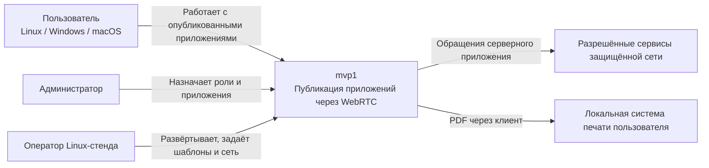
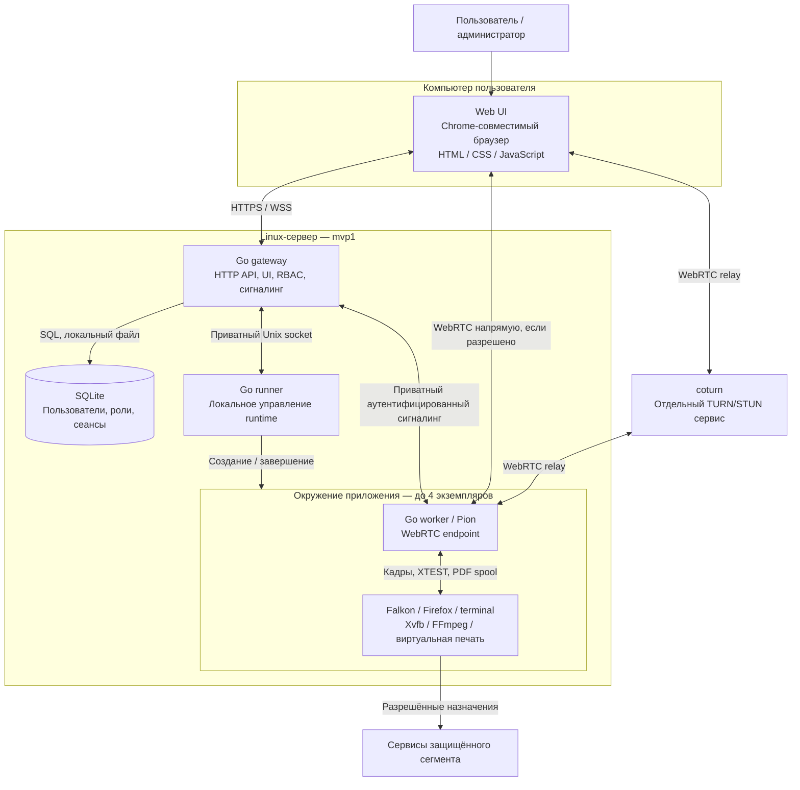
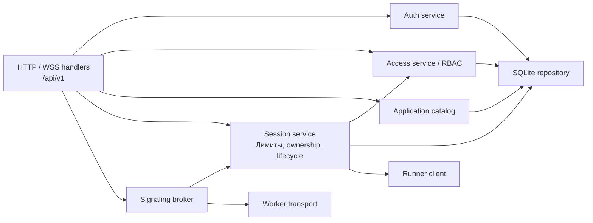
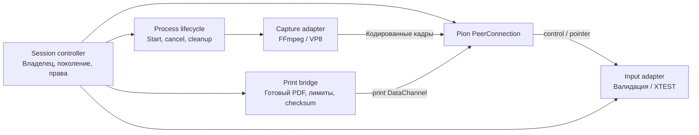
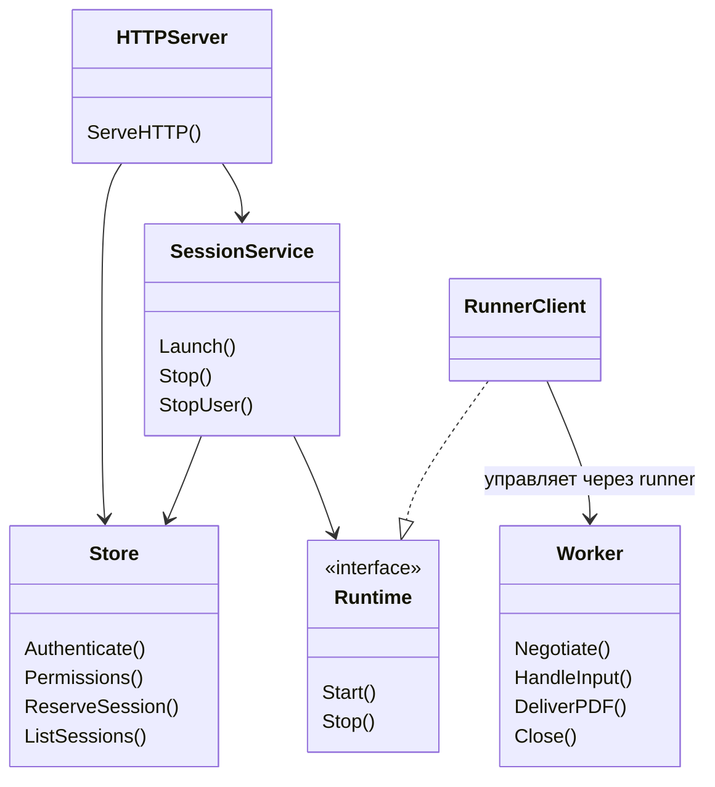
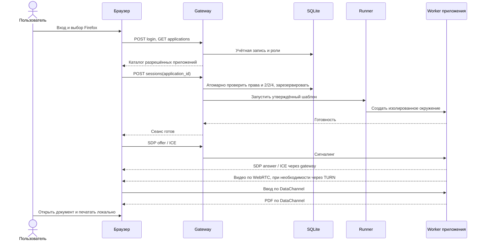
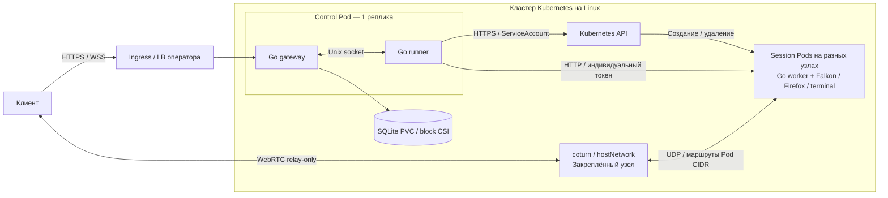

# mvp1 — C4-архитектура

Дата: 2026-09-17. Целевая архитектура принятых ADR, с отдельным указанием
границ первого инкремента. Диаграммы описаны в Mermaid. C4 container означает
исполняемую часть системы или хранилище, не обязательно Docker-контейнер.
Модель: [официальное описание C4](https://c4model.com/diagrams).

## L1 — System Context

Два независимых пользователя, по два активных приложения, максимум четыре
сеанса. Пользователь видит только разрешённые публикации. Его компьютер
не получает универсальный сетевой туннель. Администратор управляет доступом,
оператор задаёт доверенные шаблоны приложений и сетевую политику.

## L2 — Containers

| Container | Обязанности и граница доверия |
| --- | --- |
| Web UI | Вход, каталог, вкладки приложений, состояния подключения, ввод, локальная печать; не источник прав |
| Go gateway | Публичная точка входа, серверная авторизация каждого действия, выдача TURN credentials |
| SQLite | Локальная БД gateway; недоступна пользовательским окружениям |
| Go runner | Только предустановленные шаблоны; доступ к runtime не передаётся клиентам и приложениям |
| Go worker | Один сеанс, одно поколение управляющего соединения; без доступа к БД пользователей |
| Окружение | Отдельные профиль, display, spool, лимиты ресурсов и egress |
| coturn | Relay для видео и DataChannels; не SFU и не HTTP API gateway |

Falkon, Firefox, Xvfb и FFmpeg входят в worker image; виртуальный IPP-принтер реализован на Go.
Собственная серверная логика пишется на Go. Первое окружение testing и рабочее
deploy используют раздельные БД, профили, секреты и артефакты.

## L3 — Components

### Go gateway

Объединение ролей: OR разрешений с обязательным итоговым `can_launch`.
Login не занимает слот приложения. Активный пользователь — владелец хотя бы
одного незавершённого app_session. Любое незавершённое состояние, включая
preparing, ready, connecting, reconnecting и stopping, занимает слот до cleanup.
Проверка лимитов и резервирование выполняются атомарно.

### Go session worker

Старое поколение не вводит команды и не завершает новое соединение.
Права проверяются на сервере. Пропажа управляющего канала блокирует ввод и печать.
Отзыв launch закрывает приложение; logout/отключение пользователя — все его сеансы.

## L4 — Code / границы модулей

Эскиз интерфейсов, а не обещание уже существующих типов; реализация уточняется
при разработке. Основные зависимости направлены от HTTP к сервисам и адаптерам.

Go-пакеты: `internal/store`, `internal/sessions`, `internal/server`, затем
`internal/runtime`, `internal/rtc`, `internal/input`, `internal/printing`.
`web` содержит встраиваемый UI. Unit-тесты — возле пакетов, отдельные сценарии
и тестовый запуск — в `testing/`; рабочий запуск — в `deploy/`.

## Динамика клиентского пути

Terminal во второй вкладке повторяет создание независимого сеанса. Закрытие
одного приложения не влияет на другое. В будущем лимиты могут стать 2/3/6
после нагрузочной проверки.

## Эволюция и состояние реализации

- Будущий API gateway располагается перед Go backend и маршрутизирует HTTP/WSS.
  Предметная авторизация остаётся в backend; медиа не направляются через HTTP gateway.
- Возможный Electron-клиент использует те же API/WebRTC и отдельные адаптеры ОС.
- Первый инкремент: C4, SQLite/auth/RBAC/catalog, атомарные лимиты сеансов,
  браузерный UI и тесты. Второй инкремент добавляет Docker runner, Pion worker,
  Xvfb/FFmpeg, XTEST и браузерный плеер. PDF пока не реализован.
  Изоляция процессов уточнена в [ADR-006](adr/006-worker-process-isolation.md).
- Terminal с изолированной shell, одноразовые профили и PDF с локальным диалогом
  подтверждены в [ADR-005](adr/005-first-pilot-behavior.md). Перед сетевым запуском
  уточняются TURN и разрешённые сетевые назначения. Состояние готовности
  фиксируется в README проекта.

Основания: [архитектура](architecture.md), [ADR-001](adr/001-remote-app-sessions.md),
[ADR-002](adr/002-concurrent-applications.md), [ADR-003](adr/003-api-gateway-evolution.md),
[ADR-004](adr/004-client-platforms-and-mvp-experience.md).

### Реализованная печать: уточнение компонента worker

Внутри каждого worker компонент Go IPP слушает loopback `127.0.0.1:8631`.
Firefox через клиентскую библиотеку отправляет PDF этому компоненту; отдельного
демона CUPS нет. Go IPP проверяет право печати и передаёт документ в ограниченную
очередь памяти worker. Отправитель DataChannel `print` доставляет PDF только
текущему клиенту сеанса. Web UI проверяет SHA-256 и открывает PDF по действию
пользователя; локальная ОС отвечает за диалог и физическую печать.
Подробности и ограничения: [ADR-007](adr/007-go-ipp-printing.md).

## Размещение в многоузловом Kubernetes (2026-10-07)

См. [ADR-009](adr/009-kubernetes-deployment.md) и [инструкцию запуска](../deploy/kubernetes/README.md).

Gateway и runner размещаются вместе, чтобы сохранить приватный Unix socket.
Много узлов позволяют распределять приложения, но не означают несколько реплик
управляющего сервиса: SQLite и состояние сеансов требуют одного writer.
Приложения не получают ServiceAccount token. Перезапуск runner очищает его старые
Pods; продолжение прежних интерактивных сеансов после рестарта не обещается.
