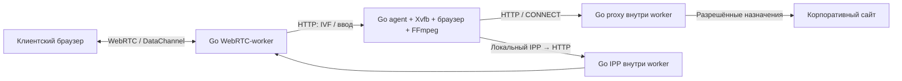

# Публикации сайтов

Принятое решение: [ADR-012](adr/012-isolated-site-publications.md).
Реализация добавлена в код; результаты проверок — в [verification](../testing/verification.md).

## Настройка

Администратор создаёт публикацию с уникальным идентификатором, названием,
Falkon/Firefox, стартовым HTTP(S) URL, доменами, IP/CIDR и TCP-портами.
После сохранения назначает права запуска, управления и печати роли.
Для индивидуального доступа создаёт отдельную роль и выдаёт её пользователю.
Пользователь видит название сайта и открывает отдельный одноразовый браузерный
профиль с заданной страницей. Разные публикации одного браузера независимы.

Пример: `yandex`, «Яндекс», Firefox, `https://ya.ru`, домен `ya.ru`, порт `443`.
Переадресации и CDN/SSO требуют дополнительных доменов. `dion.vc` разрешает
только это имя, `*.dion.vc` — все уровни поддоменов, но не apex.
Домены — ASCII/punycode. Форма преобразует одиночный IP в `/32` или `/128`.
Для частного IP, полученного через DNS, требуется явный CIDR наряду с доменом.
Стартовая страница обязана соответствовать правилам. Пустая политика запрещает
назначения. Сохранение изменённой публикации закрывает её активные сеансы.

Существующие общие Falkon/Firefox/terminal сохраняют прежний сетевой режим.
Чтобы пользователь был ограничен публикациями сайтов, отзовите его права на
общие браузеры. Ограничения двух приложений, 30 минут работы приложения и часа
пользовательского входа сохранены.

## Компоненты

Каждому сеансу соответствуют два контейнера/Pod. Worker не требует общего
файлового тома с app. App не получает worker/TURN-токены. Docker использует
отдельную internal isolated bridge и запрещает forwarding в worker.
Kubernetes использует отдельные Pod и политики пары, создаваемые до запуска.
Правила proxy неизменны в течение сеанса; DNS проверяется до соединения и
используется проверенный числовой адрес.

## Границы защиты

HTTPS CONNECT не расшифровывает TLS и не фильтрует пути URL. Проверка назначения
не гарантирует различение сайтов на общем IP при намеренной подмене SNI/Host.
Это ограничение модели сетевого allowlist, а не строгий фильтр содержимого.

Для Kubernetes обязательны CNI с NetworkPolicy, корректный `protected_cidrs`
(Service, узлы, управление) и отсутствие широких разрешающих политик для app.
Pod-сети и TURN IP renderer добавляет в запрет автоматически. Для недоступности
служб собственного узла/metadata требуется проверка host firewall/CNI policies.
Стандартная NetworkPolicy сама по себе не гарантирует такую границу.

Инструкции Docker и Kubernetes: [runbook](runbook.md),
[Kubernetes README](../deploy/kubernetes/README.md).
